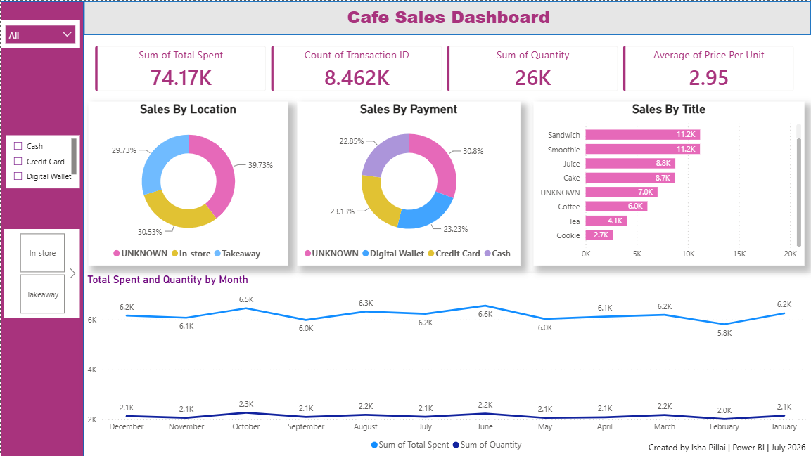

# Cafe Sales Analysis Dashboard | Power BI

An interactive Power BI dashboard built to analyze cafe sales data, with a focus on transaction performance, product sales, payment methods, locations, and monthly trends.

## Dashboard Preview



## Project Overview

This project demonstrates a practical data analytics workflow:

**Raw Data → Data Cleaning & Preparation → Power BI Analysis → Interactive Dashboard**

The source dataset contains transaction-level cafe sales information including:

- Transaction ID
- Item
- Quantity
- Price Per Unit
- Total Spent
- Payment Method
- Location
- Transaction Date

The Power BI dashboard presents key metrics and visualizations for exploring the sales data.

## Dashboard Highlights

The dashboard includes:

- Total Spent
- Transaction Count
- Total Quantity
- Average Price Per Unit
- Sales by Location
- Sales by Payment Method
- Sales by Item
- Monthly Total Spent
- Monthly Quantity
- Interactive filters for payment method and location

## Data Preparation

The raw dataset contains missing/invalid values and categorical values such as `UNKNOWN` and `ERROR`.

The project includes:
- The original raw CSV for reference
- A cleaned/processed Excel dataset
- The Power BI `.pbix` file
- A dashboard screenshot
- A dashboard walkthrough video

## Tools & Technologies

- Microsoft Power BI
- Power Query
- Microsoft Excel
- Data Cleaning
- Data Transformation
- Data Visualization
- Dashboard Design

## Key Dashboard Metrics

The dashboard shown in this repository displays:

- **Total Spent:** 74.17K
- **Transaction Count:** 8.462K
- **Total Quantity:** 26K
- **Average Price Per Unit:** 2.95

These values are the metrics displayed in the current Power BI dashboard and may change if the model/data is refreshed or modified.

## Repository Structure

```text
Cafe_Sales_Analysis/
│
├── Cafe_Sales_Analysis.pbix
├── data/
│   ├── raw/
│   │   └── dirty_cafe_sales.csv
│   └── cleaned/
│       └── cafe_sales_cleaned.xlsx
│
├── dashboard/
│   ├── dashboard.png
│   └── dashboard_walkthrough.mp4
│
└── README.md
```

## How to View the Project

1. Download `Cafe_Sales_Analysis.pbix`.
2. Open it using Microsoft Power BI Desktop.
3. Review the dashboard pages, filters, and visualizations.
4. Use the screenshot and walkthrough video for a quick preview.

## Project Purpose

The project was created to practice and demonstrate practical data analytics skills including data cleaning, transformation, KPI creation, dashboard development, and business-oriented data visualization.

## Author

**Isha Pillai**

Data Analytics | Power BI | SQL | Excel
